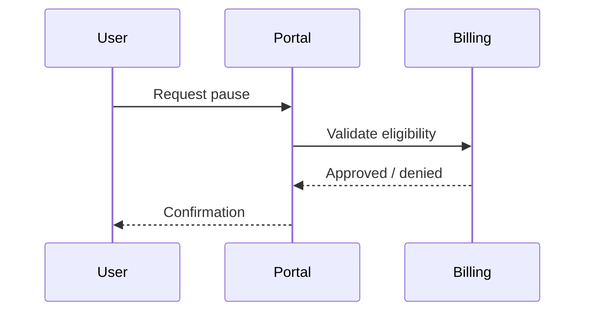

# Template C — OpenSpec / BMAD modular style

Use **modules** or **packages** with IDs. Each block should stand alone for traceability.

---

## Package metadata

| Field | Value |
|-------|-------|
| Package ID | PKG-SUB-PAUSE-001 |
| Capability | Subscription lifecycle |
| Status | Discovery |
| Owner | |

---

## Module 1 — Mission & outcome (BMAD-style)

**Mission:**  
**Desired outcome:**  
**Success criteria:**

| ID | Criterion | Observable signal |
|----|-----------|-------------------|
| SC-01 | | |

---

## Module 2 — Scope boundary (OpenSpec-style)

### In scope
| ID | Item |
|----|------|
| IN-01 | |

### Exclusions
| ID | Exclusion | Reason |
|----|-----------|--------|
| OUT-01 | | |

---

## Module 3 — Actors & workflow

| Actor | Role |
|-------|------|
| | |

---

## Module 4 — Business rules (testable)

| ID | When | Then | Else |
|----|------|------|------|
| RULE-01 | | | |
| RULE-02 | | | |

---

## Module 5 — Constraints & dependencies

| ID | Type | Description |
|----|------|-------------|
| DEP-01 | | |
| CON-01 | Legal / policy | |

---

## Module 6 — Assumptions & open questions

| ID | Assumption | Validation plan |
|----|------------|-----------------|
| ASM-01 | | |

| ID | Question | Stakeholder |
|----|----------|-------------|
| Q-01 | | |

---

## Traceability matrix (starter)

| Rule ID | Related AC / story | Test idea |
|---------|-------------------|-----------|
| RULE-01 | | |

---

**Reflection:** Which module surfaced **billing** or **Sales promise** gaps first? Could a designer read Module 3 only and still align?
