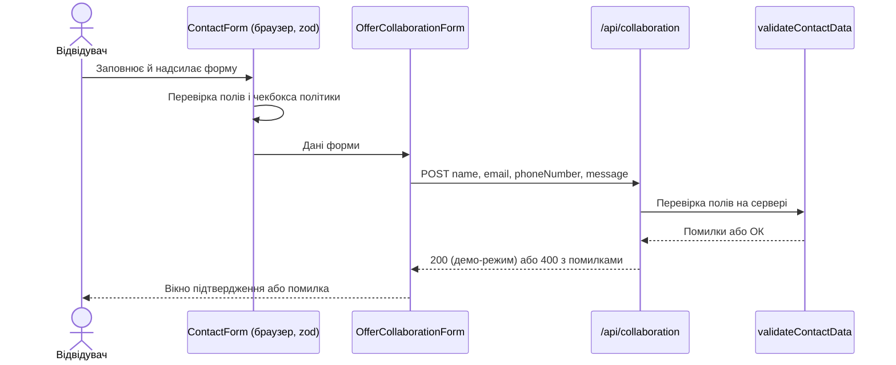

# Контактна форма: аналіз фічі і зміни (приклад)

> ЗАПАСНИЙ ПРИКЛАД для дня 2. Складений за кодом шаблону SDDwithAI26-template, перевіреним вручну: файли `app/constants/validation.ts`, `app/lib/utils/validateContactData.ts`, `app/api/contact/route.ts`, `app/api/collaboration/route.ts`, `app/shared/components/forms/contact-form/ContactForm.tsx`, `app/shared/components/forms/offer-collaboration-form/OfferCollaborationForm.tsx`, `app/services/email/emailService.ts`. Номери рядків не вказано: вони змінюються. Читайте, перевіряйте за кодом і **додайте власні правки** (див. `materials/fallback/README.md`).

## 1. Короткий опис фічі та вимоги

Фонд отримує звернення відвідувачів через форму (ім'я, email, телефон, повідомлення, згода з політикою конфіденційності). Форма стоїть на сторінці «Контакти» та в блоці партнерства. Зараз телефон необов'язковий, вкладень немає.

**Запит (issue):** зробити телефон обов'язковим; дозволити прикріплювати документ (CV чи портфоліо); сповіщення мають відображати нове поле.

**Що з'ясувалось у коді:**
- Телефон необов'язковий і на сервері, і в браузері.
- Вкладень немає ні у формі, ні в API.
- Лист-сповіщення не формується: `emailService` ніде не викликається, а API лише повертає «успіх» у демо-режимі.
- Форма на сторінці «Контакти» надсилає дані на `/api/collaboration`, а `/api/contact` не викликає жодна сторінка. У `GetNotesModal` та сама форма взагалі не звертається до API.

## 2. User stories

1. **Як** відвідувач, **я хочу** вказати телефон, **щоб** фонд міг передзвонити мені.
2. **Як** відвідувач, **я хочу** прикріпити CV або портфоліо до звернення, **щоб** фонд одразу побачив мої матеріали.
3. **Як** працівник фонду, **я хочу** отримувати сповіщення з телефоном і посиланням на вкладення, **щоб** швидко опрацьовувати звернення.

## 3. Діаграма потоку даних

Примітка: у запиті немає поля `policy` (згода з політикою), сервер про неї не знає.

## 4. Таблиця правил

| Правило | Файл | Джерело істини | Шар |
|---|---|---|---|
| Ім'я 2–50 символів | `app/constants/validation.ts`, `validateContactData.ts` | константа | API |
| Ім'я 2–50 символів, `maxLength 50` у полі | `ContactForm.tsx` | число, записане прямо в схемі zod | UI |
| Email за регулярним виразом | `validateContactData.ts` (`EMAIL_PATTERN`) | регулярний вираз | API |
| Email за `z.string().email()` | `ContactForm.tsx` | схема zod | UI (**інше правило, ніж на сервері**) |
| Телефон необов'язковий; якщо є, то `+` і цифри, 11–16 символів | `validateContactData.ts` (`PHONE_NUMBER_PATTERN`, довжини) | регулярний вираз і константи | API |
| Телефон необов'язковий, нормалізується з маски | `ContactForm.tsx`, `normalizePhoneNumberFromMask` | схема zod, допоміжна функція | UI |
| Повідомлення 10–1000 символів | `validation.ts`, `validateContactData.ts` | константа | API |
| Повідомлення 10–1000, `maxLength 1000`, текст помилки «не менше 10» | `ContactForm.tsx`, `i18n/messages` | числа в схемі й у перекладах | UI |
| Згода з політикою обов'язкова | `ContactForm.tsx` | схема zod | **лише UI** |
| Запит «приймається» у демо-режимі, нічого не зберігається і не надсилається | `app/api/collaboration/route.ts` | жорстко закодований текст | API |
| Показ повідомлення про максимальну довжину зникає автоматично | `useAutoHideMessage` | хук | UI |
| Кнопка відправки вимикається лише на час відправки | `ContactForm.tsx` (`disabled`) | властивість компонента | UI |
| Обмеження частоти запитів у переглянутих файлах не знайдено | `app/api/*` | немає | API |

## 5. Критерії приймання (для зміни з issue)

Числові межі (PDF, 5 МБ) беремо із запиту; усе, чого запит не визначає, винесено у відкриті питання.

1. **Given** форма відкрита, **When** користувач залишає телефон порожнім і натискає «Надіслати», **Then** форма показує помилку «телефон обов'язковий» і не відправляє запит.
2. **Given** телефон введено у хибному форматі (без `+` або занадто короткий), **When** користувач надсилає форму, **Then** показується помилка формату телефону.
3. **Given** телефон введено правильно, **When** користувач надсилає форму, **Then** запит відправляється.
4. **Given** користувач вибрав PDF до 5 МБ, **When** він надсилає форму, **Then** вкладення передається разом із запитом.
5. **Given** користувач вибрав файл понад 5 МБ, **When** він його вибирає, **Then** показується помилка про розмір і файл не додається.
6. **Given** користувач вибрав не PDF, **When** він його вибирає, **Then** показується помилка про тип файлу.
7. **Given** файл не вибрано, **When** користувач надсилає форму, **Then** запит відправляється без вкладення.
8. **Given** згода з політикою не поставлена, **When** користувач натискає «Надіслати», **Then** форма не відправляється (вимога лишається).
9. **Given** форма відправляється, **When** користувач дивиться на кнопку, **Then** вона вимкнена до завершення запиту (**зараз кнопка вимикається лише на час відправки**, а чи вимикати її, поки поля невалідні, див. питання 6).
10. **Given** звернення успішно прийняте, **When** фонд отримує сповіщення, **Then** воно містить телефон і посилання на вкладення (**зараз лист не формується**, див. питання 4).
11. **Given** інтерфейс українською або англійською, **When** показується помилка, **Then** вона на мові інтерфейсу.

## 6. Ключові файли

| Файл | Навіщо |
|---|---|
| `app/shared/components/forms/contact-form/ContactForm.tsx` | Форма й правила в браузері |
| `app/shared/components/forms/offer-collaboration-form/OfferCollaborationForm.tsx` | Надсилає дані на `/api/collaboration` |
| `app/api/collaboration/route.ts` | Приймає запит із форми (демо) |
| `app/api/contact/route.ts` | Така сама перевірка, але його ніхто не викликає |
| `app/lib/utils/validateContactData.ts` | Правила на сервері |
| `app/constants/validation.ts`, `app/constants/errors.ts` | Межі й тексти помилок сервера |
| `app/services/email/emailService.ts` | Заготовка листа, ніде не використовується |
| `app/services/upload/upload.ts` | Демо-заглушка завантаження |
| `i18n/messages/en.json`, `uk.json` | Тексти помилок і підписів |

## 7. Відкриті питання до стейкхолдера

1. Які типи файлів приймаємо, крім PDF, і який максимальний розмір?
2. Куди зберігається вкладення (диск, хмарне сховище, лише лист) і як довго?
3. Яка політика приватності для вкладень (персональні дані в CV)?
4. Кому і яким каналом надсилається сповіщення? (зараз лист не формується)
5. Якою мовою показувати помилки валідації, якщо мова сайту й браузера різні?
6. Яка поведінка кнопки відправки: вимкнена до валідності чи завжди активна?
7. Що робити, якщо завантаження файлу обірвалося посередині?
8. Чи потрібен захист від спаму й обмеження частоти запитів?
9. Телефон обов'язковий для всіх форм (також `GetNotesModal`) чи лише для «Контактів»?
10. Чи мають мінімальна довжина повідомлення й формат email збігатися між формою й сервером?
